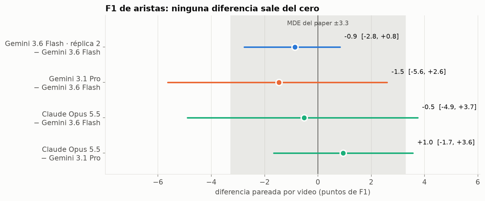
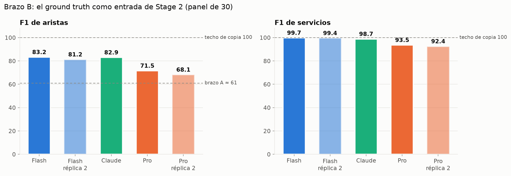
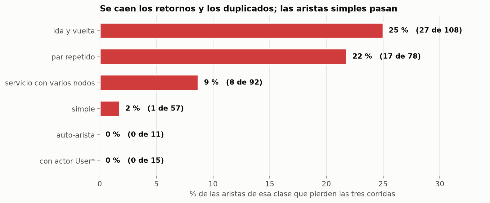
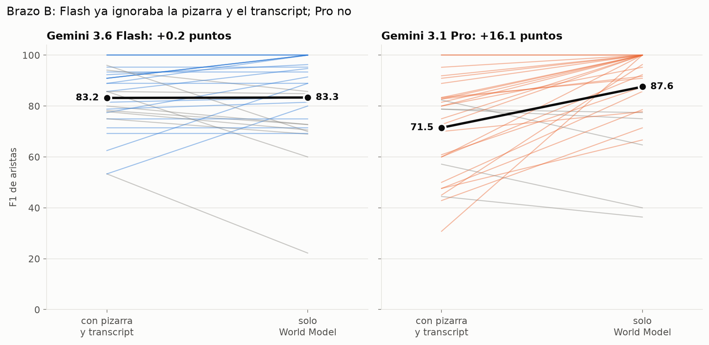
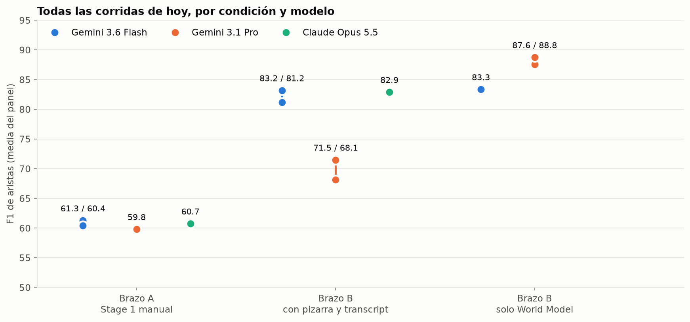
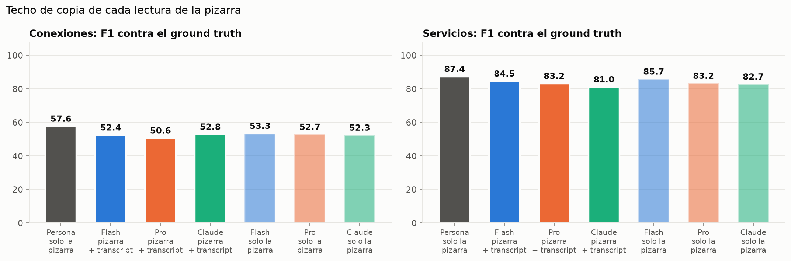
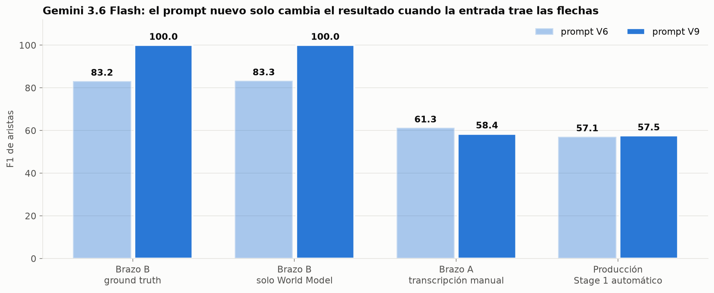

# Hipótesis verificadas el 8 de octubre de 2026

Un notebook por hipótesis. Cada uno abre con el veredicto, lista los archivos que usó, cómo se
generó cada corrida y dónde quedó, y el resto son figuras. Todas las figuras están también como
PNG en [`figuras/`](figuras/).

Todo se midió sobre el panel de 30 videos, con el prompt de producción de Stage 2
(`stage2_v6_corrected__cell9.txt`, sha `ed1d85054d73`).

| | Hipótesis | Veredicto | Notebook |
|---|---|---|---|
| H1 | Con la misma lectura de la pizarra, cambiar el modelo de Stage 2 no mueve el F1 de aristas | Se sostiene: Flash 61,3 · Pro 59,8 · Claude 60,7 | [H1](H1_invarianza_al_modelo_brazo_A.ipynb) |
| H2 | Un modelo más fuerte sube el techo de Stage 2 cuando recibe la respuesta correcta | Rechazada: Claude iguala a Flash (~83) y Pro cae a ~70 | [H2](H2_techo_de_stage2_brazo_B.ipynb) |
| H3 | La pérdida del brazo B es sistemática y se concentra en retornos y flujos paralelos | Se sostiene: 53 aristas las pierden las tres corridas; solo 1 es una arista simple | [H3](H3_la_perdida_es_sistematica.ipynb) |
| H4 | Stage 2 pierde aristas porque la pizarra y el transcript contradicen al World Model | Cierta para Pro (+16,1), falsa para Flash (+0,2) | [H4](H4_conflicto_entre_entradas.ipynb) |
| H5 | Pro cae porque rehace el grafo desde la pizarra y el transcript, y no es ruido | Se sostiene: la réplica repite el efecto (+20,6) | [H5](H5_pro_reescribe_y_ruido.ipynb) |
| H6 | Un modelo más fuerte en Stage 1 lee mejor la pizarra | Rechazada: ni Pro ni Claude superan a Flash, con o sin transcript; las seis lecturas quedan en 51–53 contra el ground truth y la persona en 57,6 | [H6](H6_cuanto_lee_stage1.ipynb) |
| H7 | Con la respuesta correcta delante, lo que impide a Stage 2 transportarla es el prompt | Se sostiene en el brazo B con los tres modelos (Flash 83,2 → 100,0 · Claude 82,9 → 97,5 · Pro 71,5 → 93,7 con el prompt V9) y no se traslada a producción (+0,4 y 0,0 en dos corridas) | [H7](H7_el_prompt_es_el_cuello_en_el_brazo_B.ipynb) |

## Las figuras principales

**H1 · Tres modelos, el mismo F1 de aristas**

**H2 · Con la respuesta delante, nadie pasa de ~83**

**H3 · Se caen los retornos y los duplicados**

**H4 · Quitar la pizarra y el transcript solo cambia a Pro**

**H5 · Todas las corridas, con sus réplicas**

**H6 · Cuatro lecturas automáticas de la pizarra y la de la persona, contra el ground truth**

**H7 · El prompt nuevo solo cambia el resultado cuando la entrada trae las flechas**

## Condiciones

| condición | qué recibe Stage 2 |
|---|---|
| Brazo A | transcripción manual de la pizarra (`world_model_vision.json`) + pizarra + transcript |
| Brazo B | ground truth convertido a World Model (`world_model_oracle_gt.json`) + pizarra + transcript |
| Brazo B, solo World Model | ground truth convertido a World Model, sin pizarra ni transcript |

## Dónde está cada corrida

Las rutas exactas están en `RUNS`, al inicio de [`comun.py`](comun.py). En resumen:

- `reports/pro_vs_flash/`: Flash y Pro en las tres condiciones, y las réplicas de Pro.
- `reports/claude/` y `reports/claude_oracle_gt/`: Claude Opus 5.5 en los brazos A y B.
- `reports/stage1_vs_manual/`: Stage 1 de Flash y Pro, con y sin transcript, contra la transcripción manual (H6). Los World Models están en `whiteboard_selection_lab/lab_workspace/<vid>/world_model_s1-*.json`, fuera de git.
- `reports/prompt_v9/`: Flash con el prompt `stage2_v9_connection_ledger.txt` en las cuatro condiciones (H7).
- `reports/ablation/*oracle-oracle_gt*` y `*oracle-vision`: las corridas de Flash de agosto, que sirven de referencia y de réplica.

## Para volver a ejecutarlos

Los notebooks solo leen los `run.json` y el ground truth; no llaman a ningún modelo. Necesitan
numpy, matplotlib y Pillow, y se ejecutan desde esta carpeta porque importan `comun.py`.

## Pendiente

- Réplicas de V9 con Pro y con Claude en el brazo B (una sola corrida cada uno).
- Probar el bloque "Connection Ledger" sin reescribir las otras dos reglas. Ya se sabe que quitar
  solo "Unidirectional Default" no cambia nada (81,9 frente a 83,2 y 81,2).
- De dónde salen las flechas de la referencia que no están en la pizarra: narración o convención de
  anotación. Hoy sigue saliendo por resta.
